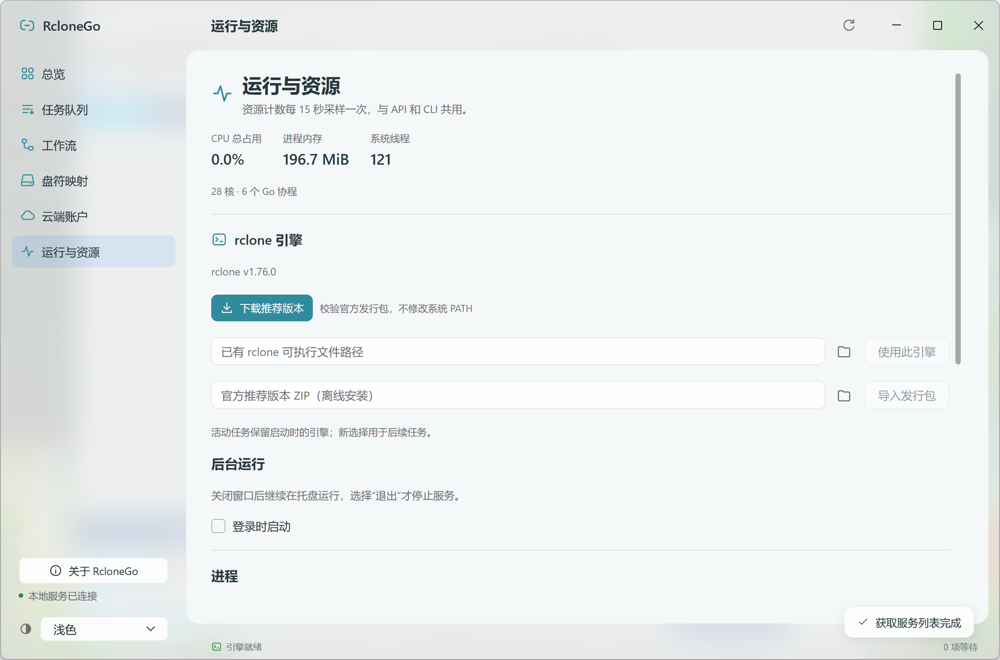

<p align="center"></p>
<p align="center">Reliable transfers. Visible workflows.</p>
<p align="center">
  <a href="README.md">English</a> · <a href="README.zh-CN.md">简体中文</a> ·
  <a href="https://github.com/DeliciousBuding/rclonego/releases">Downloads</a> ·
  <a href="docs/agents.md">Agent API</a>
</p>
<p align="center">
  <a href="https://github.com/DeliciousBuding/rclonego/actions/workflows/check.yml"></a>
  <a href="LICENSE"></a>
  <a href="https://mygo.egoist.dev/"></a>
</p>

RcloneGo is a native desktop workspace for transfers, mounts and verification,
powered by [rclone](https://rclone.org/) and built with
[MyGo](https://mygo.egoist.dev/). Its GUI, CLI and authenticated local API share
one persistent scheduler.

This is an independent community project under active alpha development.
It is not an official rclone or MyGo application.

<p align="center"></p>

## What it does

- **Transfer with evidence.** Copy, single-file copy, one-way mirror and checks.
  Reusable workflows create separate runs with ordered steps and retained attempts.
- **See and control execution.** Current folders/files, resource counters,
  concurrency, bandwidth, schedules, queue pause and task pause/resume.
- **Connect storage.** Verified engine installation, offline import, provider-driven
  account setup, browser OAuth and read verification. Mounts stay under recorded ownership.
- **Work from any interface.** Native light/dark/system appearance, tray background
  operation, English/Chinese UI, CLI JSON, offline OpenAPI, event streaming and
  revocable observer/task tokens.
- **Reuse and automate.** Edit, clone, import and export workflows. Opt-in
  directory watching and recurring workflows submit to the same queue.
- **Choose and inspect paths.** Browse cloud folders, inspect structured dry-run
  changes, observe owned VFS cache/writeback state and save independent offline copies.

A mirror requires a matching dry-run preview and explicit deletion permission.
Verification reports distinguish sizes, available hashes and content-download
comparison. A completed copy is not automatically a completed content check.
Partial workflows verify the selected top-level entries and their descendants.
Storage failures suspend new dispatch until recovery. Hidden windows stop UI polling;
idle windows refresh less often, and logs have bounded retention.

## Install

Choose a package from [Releases](https://github.com/DeliciousBuding/rclonego/releases).
Preview packages are marked as prereleases; no stable version is available yet.

| Platform | Package and validation |
| --- | --- |
| Windows amd64 | Portable executable or installer; native UI and packaged CLI tested |
| Linux amd64 | `.deb` or `.tar.gz`; Ubuntu WSLg UI, transfers and FUSE mount/read/unmount tested |
| macOS arm64 | `.dmg` or application ZIP; build and synthetic CI tests, manual native validation pending |

Other amd64/arm64 combinations can be cross-built, with runtime support pending.
Windows packages are not Authenticode signed; macOS packages are not Developer ID
notarized. SHA256SUMS verifies artifact integrity and does not replace OS signing.

Windows portable users can copy the executable alone. SQLite is embedded and
extracted to a verified private cache on first use. On Linux, use the packaged
install script or the distribution package.

Open **Settings → rclone engine** to download the pinned official rclone release, select an
existing executable or import its verified ZIP offline. This does not modify PATH
or a package-manager installation. Mounts separately require WinFsp on Windows,
FUSE on Linux, or a compatible FUSE/engine combination on macOS.

The [Settings page](assets/screenshots/settings-light.png) contains appearance, interface language, login startup,
client updates and collapsible defaults for new tasks. **Resources** shows
current process usage and live bandwidth controls.

## First workflow

1. Open RcloneGo and install or select an engine.
2. Add an account or use local directories. Google Drive requires your own OAuth
   Client ID; see [account setup](docs/accounts.md).
3. Create a copy task, or save a directory workflow with final verification.
4. Observe the queue and read the execution report.

Task forms keep preview and submission actions visible while options scroll.
Run results show the completed steps, verification method and scope, with a
recovery action for unfinished work.

Closing a window keeps the service running when a tray is available. Use **Quit**
to stop the service. Without tray support, closing exits. Restart recovery
compares source and destination again; file-internal resume depends on the backend.

## CLI and Agents

```sh
rclonego --help
rclonego schema
rclonego status --json
rclonego engine install
rclonego workflows save --file workflow.json --json
rclonego workflows run <workflow-id> --json
rclonego runs wait <run-id> --timeout 1h --json
rclonego runs report <run-id> --json
```

The CLI discovers the same local instance as the GUI. For an isolated profile,
set `RCLONEGO_DATA`; `RCLONEGO_TOKEN_FILE` selects a private token file.
Ctrl+C stops waiting without cancelling the task.

See the [Agent guide](docs/agents.md), [API](docs/api.md),
[architecture](docs/architecture.md) and [privacy](docs/privacy.md).
See [automations](docs/automation.md), [mount caching](docs/mounts.md) and
[languages](docs/languages.md). Automatic copies retain destination-only files.
Bidirectional synchronization, separate-daemon GUI attachment and MCP remain
future work. The official MyGo native updater supports signed releases and
stable/preview channels; the release page identifies which builds/feed are available.
Renamed standalone Windows executables use manual updates.

## Develop and contribute

Requires Go 1.27.3+ and Python 3.12+. Native UI needs no JavaScript toolchain.

```sh
go run ./cmd/rclonego
go test ./...
go vet ./...
python scripts/test.py
python scripts/build.py --platform windows/amd64
```

`scripts/test.py` downloads a verified temporary integration engine. Add
`--installer` to the Windows build to create an installer. `-data`, `-rclone`
and `-config` select explicit private state, engine and config paths.
The default app configuration starts empty and does not take over existing uploads.

Read [CONTRIBUTING](CONTRIBUTING.md) for focused changes and UI verification,
[releasing](docs/releasing.md) for packaging, and [SECURITY](SECURITY.md) for private
security reports. Source uses [Apache-2.0](LICENSE); dependencies and service
marks retain their [own terms](docs/third-party.md).
License texts are embedded in the portable executable and available through
About or `rclonego licenses`.
