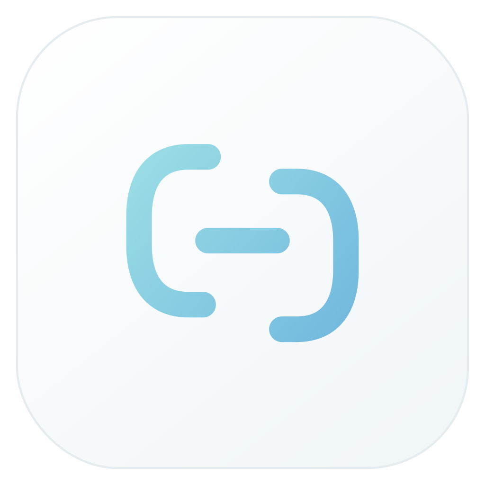

# RcloneGo

**Reliable transfers. Visible workflows.**

A native workspace for cloud transfers, verification and automation.
Powered by [rclone](https://rclone.org/). Built with [MyGo](https://mygo.egoist.dev/).



RcloneGo is an independent community project. It is not an official rclone or
MyGo application.

## Development preview

This repository is under active development. There is no stable release yet.

The current baseline includes:

- Native UI with light, dark and system appearance.
- A persistent queue for copy, single-file copy, one-way mirror and checks.
- Ordered directory workflows with a final verification step.
- Reusable workflow definitions, separate runs and retained execution attempts.
- Restart recovery, parameter controls and live transfer information.
- A loopback API and CLI that operate the same scheduler.
- An isolated application rclone configuration by default.
- SQLite transactions and state-change events.

Verification reports distinguish size checks, available backend hashes and
explicit content comparison. A completed transfer is not automatically a
completed content verification.

## Build and run

Requires Go 1.27.3 or later. A native UI build needs no JavaScript toolchain.
Install an official [rclone binary](https://rclone.org/install/) for transfers.
The UI can open without an available engine.

```sh
go test ./...
go vet ./...
python scripts/build.py
```

MyGo packages the SQLite native library with the application; keep the generated
application files together. The rclone engine remains a separately selected
executable. Managed engine downloads and standalone distribution packaging are
planned.

For development:

```sh
go run ./cmd/rclonego
go run ./cmd/rclonego serve
go run ./cmd/rclonego --help
```

`-rclone` selects an engine, `-data` selects private application state and
`-config` explicitly selects an existing rclone configuration. Without `-config`,
RcloneGo creates an empty application configuration and does not import accounts.

## CLI

```sh
rclonego status
rclonego doctor
rclonego jobs list --json
rclonego workflows save --file workflow.json
rclonego workflows list
rclonego workflows run <workflow-id> --json
rclonego runs report <run-id>
rclonego runs wait <run-id> --timeout 1h --json
```

The CLI discovers the local running instance. For a separate development profile,
set `RCLONEGO_DATA` to its state directory. An explicit API URL may be selected
with `--api` or `RCLONEGO_API`; `RCLONEGO_TOKEN_FILE` selects its private token file.
Authentication tokens should not be passed as command-line arguments.

See [API](docs/api.md), [architecture](docs/architecture.md) and
[privacy](docs/privacy.md).

## Platform status

| Platform | Current scope |
| --- | --- |
| Windows amd64 | Primary development target; native UI and synthetic transfer/recovery tests |
| Windows arm64 | Build target; native runtime validation pending |
| macOS amd64/arm64 | Experimental build targets; native runtime validation pending |
| Linux amd64/arm64 | Experimental build targets; native runtime validation pending |

Windows mount management requires WinFsp. macOS/Linux mount management and
process resource counters are not implemented in this baseline. Transfer and
verification support do not require a mounted filesystem.

## Verification

`go test ./...` includes a real local transfer/recovery test when rclone is
available. Set `RCLONEGO_TEST_ENGINE` to test a particular engine. That test uses
temporary synthetic directories and an empty configuration.

## License

RcloneGo source is licensed under [Apache-2.0](LICENSE).
Dependency licenses and service trademarks retain their own terms; see
[third-party notices](docs/third-party.md).
