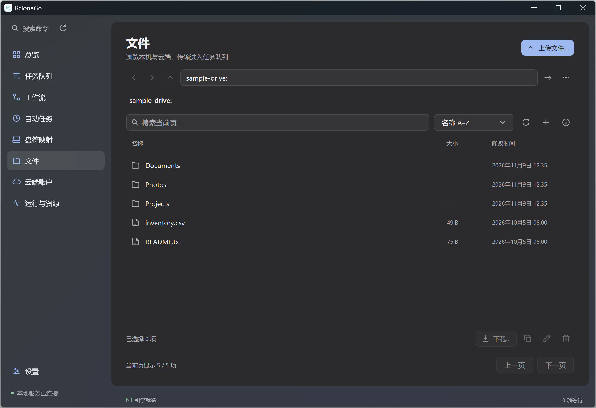

<p align="center"></p>
<p align="center">可靠传输，过程可见。</p>
<p align="center">
  <a href="README.md">English</a> · <a href="README.zh-CN.md">简体中文</a> ·
  <a href="https://github.com/DeliciousBuding/rclonego/releases">下载</a> ·
  <a href="docs/agents.md">Agent API</a>
</p>
<p align="center">
  <a href="https://github.com/DeliciousBuding/rclonego/actions/workflows/release.yml"></a>
  <a href="LICENSE"></a>
  <a href="https://mygo.egoist.dev/"></a>
</p>

RcloneGo 是管理传输、挂载与校验的原生桌面客户端，由
[rclone](https://rclone.org/) 驱动，使用 [MyGo](https://mygo.egoist.dev/)
构建。图形界面、CLI 和经过认证的本地 API 共用一个持久化调度器。

项目处于 alpha 开发阶段，是独立社区项目，不代表 rclone 或 MyGo 官方。

**版本状态：**本页描述 alpha.3 开发源码，最新公开预览版仍为
[v0.1.0-alpha.2](https://github.com/DeliciousBuding/rclonego/releases/tag/v0.1.0-alpha.2)。
alpha.3 新增能力需要从源码构建，或使用后续公开预览版；目前尚无稳定版。

<p align="center"></p>

## 主要能力

- **可核验的传输。** 复制、单文件复制、单向镜像与校验。保存工作流，
  每次执行生成独立 Run、顺序步骤和尝试记录。
- **可观察与控制的过程。** 当前目录和文件、资源计数、并发与限速、计划时间、
  暂停队列，以及暂停和恢复当前任务。
- **完整的存储接入流程。** 校验官方引擎、离线导入、按服务元数据逐步配置、
  浏览器 OAuth 和读取验证。挂载由记录的进程归属管理。
- **人类与 Agent 共用。** 原生浅色、深色、跟随系统主题，托盘后台运行，
  中英文界面、CLI JSON、离线 OpenAPI、事件流和可撤销的观察/任务 token。
- **复用与自动运行。** 编辑、复制、导入导出工作流；目录监听和周期执行复用同一队列。
- **选择与检查路径。** 浏览云端目录、查看结构化更改预览、观察挂载缓存与写回，
  保存独立的本机离线副本。
- **管理文件。** [文件工作页](docs/files.md) 支持目录导航、多选、文本与图片预览、
  上传下载、复制、重命名和确认删除文件或空目录；展示现有 Windows rclone 盘符。
- **了解存储状态。** 读取服务返回的容量、校验算法与后端能力；浏览文件大小，
  按需统计目录并可取消；系统里的其他 rclone 与本客户端分别展示资源占用。
- **接续旧客户端。** 预览导入 Data Ops Console 的任务，保留步骤顺序和排除证明，
  当前上传完成后由统一队列接续后续步骤。

镜像同步要求先 dry-run 预览，再明确授权删除。报告区分大小、可用哈希与下载内容对比；
复制完成不等于内容校验完成。
部分工作流只校验所选顶层条目及其内容。存储失败会暂停新任务调度，等待恢复。
隐藏窗口停止 UI 轮询，空闲窗口降低刷新频率；日志保留数量与容量有界。

## 安装

从 [Releases](https://github.com/DeliciousBuding/rclonego/releases) 选择发行包。
实际可下载的包与平台验证范围以对应发行页为准。

| 平台 | 包形式与验证范围 |
| --- | --- |
| Windows amd64 | 推荐当前用户 EXE 安装器，另提供免安装 ZIP/exe；已验证原生界面/CLI、升级与卸载的数据保留 |
| Windows arm64 | EXE 安装器和免安装包；已配置原生发行 runner，人工验收待完成 |
| Linux amd64 | `.deb` 或 `.tar.gz`；已验证 Ubuntu WSLg、传输及 FUSE 挂载读取与卸载 |
| macOS amd64 / arm64 | 推荐 DMG，另提供 app ZIP；已配置 Intel/Apple Silicon 原生发行 runner，人工原生验收待完成 |

每次发行会列明实际可下载的包与验证范围，已配置构建目标不等于已经公开发行。
Windows 包尚无 Authenticode 签名，macOS 包尚无 Developer ID 公证。
SHA256SUMS 用于校验产物完整性，不能替代系统签名。

Windows 双击安装器后从开始菜单启动。macOS 打开 DMG，将 RcloneGo 拖入
Applications，弹出磁盘映像后启动已安装的应用。详细步骤见[安装、更新与卸载](docs/install.md)。
Windows 免安装版可单独运行 exe，但账户与任务历史默认仍保存在用户目录。
SQLite 已嵌入程序，首次使用时释放到经过校验的私人缓存。

在“设置 → rclone 引擎”中下载推荐的官方 rclone、选择已有引擎，或离线导入经过校验的 ZIP。
客户端不修改 PATH，也不覆盖包管理器安装。挂载组件单独安装：
Windows 使用 WinFsp，Linux 使用 FUSE，macOS 需要兼容的 FUSE 与引擎构建。

[“设置”页面](assets/screenshots/settings-light.png)统一管理外观、语言、登录启动、客户端更新和新任务默认参数；
引擎与默认参数可按需展开。“运行与资源”显示当前占用和即时限速控制。
新配置默认跟随系统主题与语言，手动选择会保留。alpha 的登录启动与自动检查更新默认关闭。

## 开始第一个工作流

1. 启动 RcloneGo，安装或选择引擎。
2. 添加云端账户，或直接使用本机目录。Google Drive 使用自己的 OAuth Client ID，
   见[账户接入](docs/accounts.md)。
3. 创建复制任务，或保存带最终校验的目录工作流。
4. 在队列观察过程，完成后查看执行报告。

展开参数时，预览和提交按钮仍固定可见。执行结果显示完成步骤、实际校验方式和范围，
未完成的工作流可从结果窗口恢复。

桌面支持托盘时，关闭窗口会继续后台运行，选择“退出”才停止服务。
没有托盘时，关闭窗口会退出。重启恢复会重新比较源与目标；
文件内部能否从断点续传取决于后端。

## CLI 与 Agent

```sh
rclonego --help
rclonego schema
rclonego status --json
rclonego engine install
rclonego workflows save --file workflow.json --json
rclonego workflows run <workflow-id> --json
rclonego runs wait <run-id> --timeout 1h --json
rclonego runs report <run-id> --json
```

CLI 自动发现与界面相同的本地实例。隔离开发配置使用 `RCLONEGO_DATA`，
私人 token 文件通过 `RCLONEGO_TOKEN_FILE` 指定。
Ctrl+C 只停止等待，不取消后台任务。

详见 [Agent 指南](docs/agents.md)、[API](docs/api.md)、
[架构](docs/architecture.md)与[隐私说明](docs/privacy.md)。
详见[自动任务](docs/automation.md)、[挂载缓存](docs/mounts.md)和[语言](docs/languages.md)。
自动复制保留目标独有文件；双向同步、独立 daemon 的 GUI 接入和 MCP 仍是后续工作。
MyGo 官方原生更新器支持签名发行包及稳定版/预览版通道，实际可用构建与更新源见发行页。
重命名后的 Windows 单独 exe 使用手动更新。

## 开发与贡献

需要 Go 1.27.3+ 与 Python 3.12+。原生 UI 不需要 JavaScript 工具链。

```sh
go run ./cmd/rclonego
go test ./internal/ui
go vet ./internal/ui
python scripts/build.py --platform windows/amd64
```

其他改动将示例中的 `internal/ui` 替换为受影响的包。
`scripts/test.py` 提供经过校验的临时集成测试引擎。
Windows 构建添加 `--installer` 生成安装器。
`-data`、`-rclone` 和 `-config` 分别指定私人状态、引擎与配置；
默认使用空白应用配置，不自动接管已有上传。
日常改动使用针对受影响部分的本地检查。push、PR 和 tag 都不触发 Actions；
需要完整平台发行包时，由维护者针对已有版本 tag 手动运行 Release。

贡献和界面验收见 [CONTRIBUTING](CONTRIBUTING.md)，
打包见[发行指南](docs/releasing.md)，私密安全报告见 [SECURITY](SECURITY.md)。
源码采用 [Apache-2.0](LICENSE)，依赖与服务标志保留[各自的许可](docs/third-party.md)。
便携 exe 已嵌入许可文本，可在“关于”或 `rclonego licenses` 中查看。
